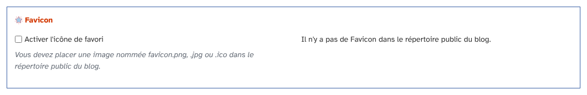
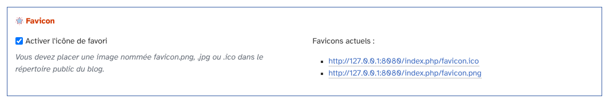

# simplyFavicon : guide d'utilisation

simplyFavicon ajoute l'icône de votre blog, le « favicon », dans l'onglet du navigateur et dans les favoris. Il suffit de déposer l'image dans le dossier public de Dotclear et d'activer l'option.

Le plugin n'a pas de page d'administration. Son réglage se trouve dans les paramètres du blog.

## Sommaire

* [Déposer l'image](#déposer-limage)
* [Activer le plugin](#activer-le-plugin)
* [Ce que le plugin ajoute aux pages](#ce-que-le-plugin-ajoute-aux-pages)
* [Bon à savoir](#bon-à-savoir)

## Déposer l'image

Placez un fichier nommé `favicon.ico`, `favicon.png` ou `favicon.jpg` dans le dossier public du blog. Par défaut, c'est le dossier `public`, à côté du fichier `index.php` de Dotclear.

Le nom du fichier doit être exactement `favicon`, suivi de l'extension. Les formats `bmp`, `gif` et `mng` sont aussi reconnus.

## Activer le plugin

1. Allez dans « Paramètres du blog ».
2. Ouvrez « Paramètres des plugins pour ce blog ».
3. Dans la section « Favicon », cochez « Activer l'icône de favori ».
4. Enregistrez.

Tant qu'aucune image n'est déposée, la section vous le dit : « Il n'y a pas de Favicon dans le répertoire public du blog. ».

Quand des images sont présentes, la section les liste sous « Favicons actuels : ». Chaque lien ouvre l'image telle que les visiteurs la reçoivent.

## Ce que le plugin ajoute aux pages

Le plugin ajoute des balises `<link>` dans l'en-tête de chaque page publique du blog. Il ne retient qu'une seule image : le premier fichier trouvé dans cet ordre : `ico`, `png`, `bmp`, `gif`, `jpg`, `mng`.

* Pour un fichier `ico`, il déclare l'icône de raccourci.
* Pour un fichier `png`, il déclare aussi l'icône pour les appareils d'Apple (`apple-touch-icon`).

Les images sont servies à l'adresse du blog, par exemple `…/index.php/favicon.png` selon la configuration de votre site.

## Bon à savoir

* Si vous avez à la fois un `favicon.ico` et un `favicon.png`, seul le `ico` est déclaré dans l'en-tête des pages.
* Le message du réglage ne parle que de `png`, `jpg` et `ico`, mais les autres formats fonctionnent aussi.
* Si l'option est décochée, ou si aucune image n'est présente, le plugin n'ajoute rien aux pages.
* Une adresse de favicon dont l'extension n'est pas reconnue, ou dont le fichier n'existe pas, renvoie une erreur 404.
